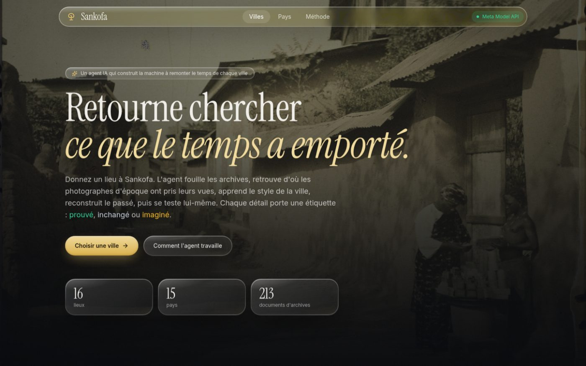
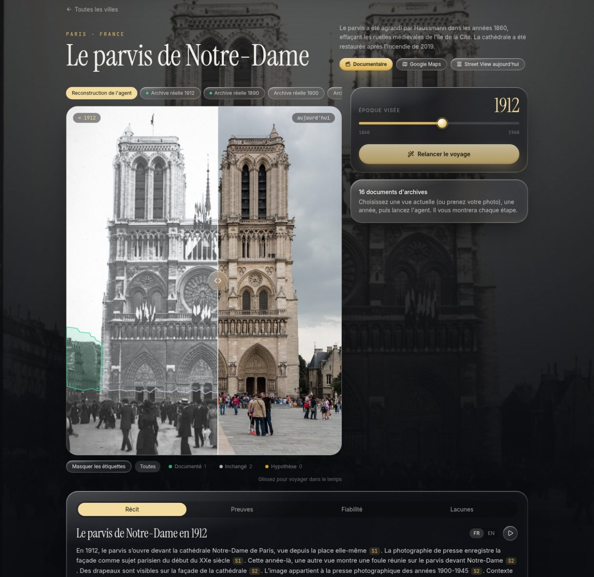
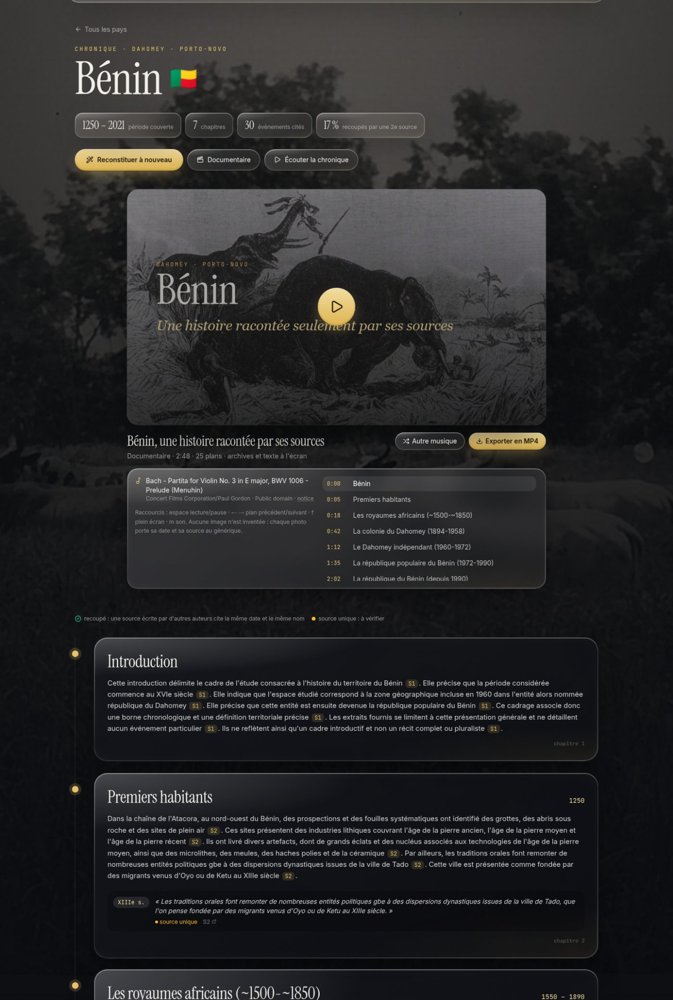
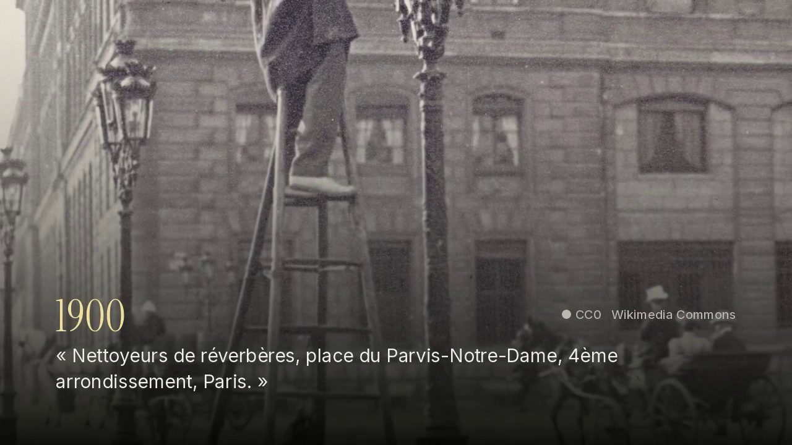
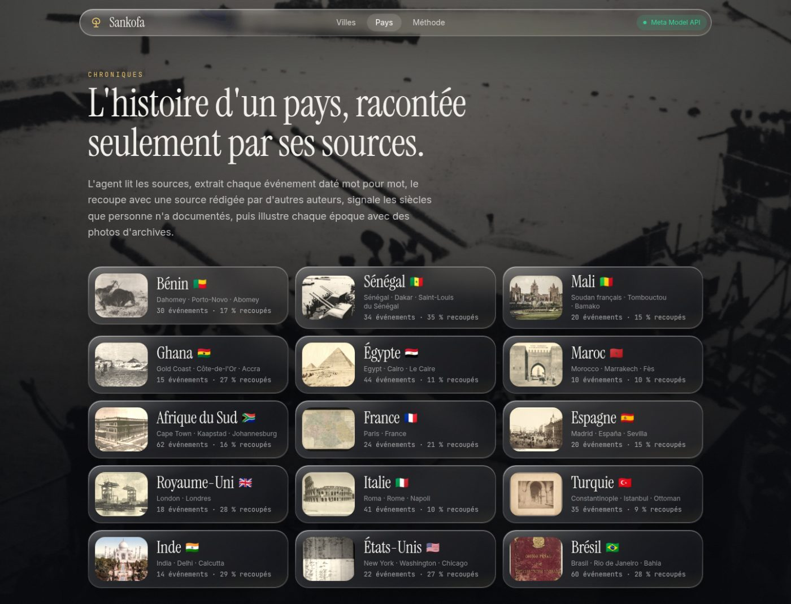

# SANKOFA

**An AI agent that builds a time machine for any city, and tells you what is proven and what is imagined.**

> *Sankofa* is an Adinkra symbol from Ghana: a bird looking back over its shoulder. It means *"go back and fetch what you left behind."*

Built for the **Meta Global AI Developer Hackathon 2026** (Indie track, theme *Build for Your World*) by KOBA David, Benin.



---

## The problem

The visual history of cities, and of African cities above all, is scattered across distant archives in Paris, Washington or Amsterdam. People living in Porto-Novo or on Gorée Island almost never get to see what their street looked like a hundred years ago.

Generative AI can now "age" any photo in one click. But it invents silently: a beautiful fake image of the past damages collective memory instead of serving it.

**SANKOFA brings the archives home, and never lets the AI pass imagination off as history.**

## What SANKOFA does

### 1. A time machine for places

Give SANKOFA a place and a year. An agent does the work of a historian and of an ML engineer, live, in seven visible steps:

| # | Step | What the agent does | Engine |
|---|------|---------------------|--------|
| 1 | **Investigate** | Searches open archives by keyword and by GPS coordinates, keeps only open licenses, then looks at each image to check that it really shows the place at that time | **Muse Spark 1.3** (vision) |
| 2 | **Annotate** | Cuts today's view into buildings, road and sky, with pixel-accurate masks | **SAM 3.1** |
| 3 | **Re-photograph** | Finds where each period photographer stood (feature matching + RANSAC) and warps the archive onto today's view | OpenCV |
| 4 | **Learn the style** | Learns the city's photographic look for that decade: tone curve, tint, grain | profile learned from the corpus |
| 5 | **Reconstruct** | Areas proven by an archive come from the archive itself. Only areas with no evidence are handed to the generative model | **Muse Image** |
| 6 | **Self-evaluate** | Hides an archive, rebuilds without it, compares, and computes a reliability score | SSIM, evidence coverage |
| 7 | **Narrate** | Writes a short history of the place in French and English, every sentence citing its source, no invented detail | **Muse Spark 1.3** |

Every region of the image gets a verdict: **documented** (green), **unchanged** (grey) or **hypothesis** (yellow). The agent lists what it does not know and asks the community for the missing photos or oral testimonies.



*Notre-Dame de Paris: a real press photograph from 1912 (crowd, flags) is warped onto a 2014 view. SAM 3.1 outlines the buildings; the cathedral is classified as unchanged.*

A **re-photography guide** overlays the archive on the phone camera, so anyone standing in the street can find the exact angle of the 1900 photographer and give the agent a perfect match.

### 2. Country chronicles: history told only by its sources

The same principle applied to a whole country. The agent:

1. reads the country's history in two independently written sources (Wikipedia in French **and** in English);
2. extracts every dated event **word for word** (years, centuries, BC dates), each linked to the section it comes from;
3. filters out what is not an event: historiography, statistics ("395 articles", "191 grams"), lists of links;
4. **cross-checks** each event: it is *corroborated* when the other source gives the same year with the same proper noun, otherwise *single source*;
5. flags **what the sources leave out**: centuries with no date, thinly dated chapters, missing oral traditions;
6. illustrates each era with archive photos searched under the country's **former names** (Dahomey, Gold Coast, Constantinople…);
7. writes the narrative with Muse Spark from those excerpts only, every sentence cited, and says when the excerpts reflect a single point of view (for example a colonial one).



### 3. Documentaries

Every country and every place can be watched as a short documentary, in a YouTube-style player built into the page (small, medium, cinema and full-screen sizes, clickable chapters, keyboard shortcuts):

- real archive photos with slow camera moves, each one captioned with its date and place;
- events quoted on screen with their *corroborated* or *single source* badge;
- for a place, today's view slowly dissolving into the past;
- a random public-domain soundtrack (Satie, Chopin, Debussy, Bach, Mozart, Beethoven, Schubert, Grieg);
- full credits for every photo, source and recording.

Documentaries export to **MP4** (1280×720, H.264 + AAC) with ffmpeg.



---

## Coverage

**16 places in 15 countries, 213 archive documents, 15 country chronicles.**

| Continent | Places |
|---|---|
| Africa | Porto-Novo and Cotonou (Benin), Gorée Island (Senegal), Giza pyramids (Egypt), Great Mosque of Djenné (Mali), Cape Coast Castle (Ghana), Jemaa el-Fna (Morocco), Adderley Street in Cape Town (South Africa) |
| Europe | Notre-Dame parvis (France), Puerta del Sol (Spain), Tower Bridge (United Kingdom), Colosseum (Italy), Hagia Sophia (Turkey) |
| Americas | Flatiron Building (United States), Pelourinho in Salvador de Bahia (Brazil) |
| Asia | Taj Mahal (India) |

Real archive overlays verified by eye: **Paris** (1890, 1900, 1912), **Rome** (the Colosseum around 1880) and **Agra** (the Great Gate of the Taj Mahal in the 1880s). Elsewhere, no open photo is taken from the same angle as an archive, and the agent says so.



---

## Meta AI tooling

| Model | Used for |
|---|---|
| **Muse Spark 1.3** (Meta Model API) | Visual verification of every archive, cited narratives for places and chapters, critical reading of sources |
| **SAM 3.1** (Meta Model API, Responses API) | Concept segmentation of today's view; masks decoded with Meta's official `meta-sam-parser` |
| **Muse Image** (Meta Model API) | Reconstruction of areas with no evidence only, always labelled *hypothesis* |
| **Muse Voice Transcribe** (Meta Model API) | Transcription of oral testimonies contributed by the community |
| **Muse Spark open** (open weights, served by Baseten) | Fallback for text and vision when no Meta Model API key is set |

Muse Spark reasons before answering: SANKOFA calls it with `reasoning_effort="low"` and a generous token budget, and only keeps what the sources support. Every step of the agent log states which engine did the work (`Meta · sam-3.1`, `Meta · muse-spark-1.3`, `local`).

## Honesty by design

- **No invented archive.** Documentaries and chronicles only show real photos, each credited with its license and source link.
- **Generation is quarantined.** Muse Image only fills areas no archive covers, and those areas are marked *hypothesis*.
- **Reliability is measured, not declared**: share of buildings backed by evidence, corpus richness, blind test on a hidden archive. Without any archive taken from the same angle, the blind test is impossible and the score is capped at 70%.
- **The agent knows what it does not know**: gaps in the sources are shown, not filled.
- **Filters against false matches**: homonyms (a "Flatiron" in Florida, the "Puerta del Sol" of Toledo), maps, portraits, census records, scanned science books, paintings, and "current" views that are really old scans dated by their upload year.

## Architecture

```
frontend/  React 19 · Vite · Tailwind 4 · Framer Motion · Leaflet   (liquid glass interface)
   │  REST + Server-Sent Events (live agent log)
backend/   FastAPI · OpenCV · NumPy · Pillow · ffmpeg
   ├── sankofa/agent.py         the 7-step place agent
   ├── sankofa/chronicle.py     country chronicles
   ├── sankofa/documentary.py   storyboards and MP4 rendering
   ├── sankofa/investigate.py   archive search, relevance and license filters
   ├── sankofa/vision.py        segmentation fallback, re-photography, style, metrics
   ├── sankofa/meta.py          Meta Model API and Baseten clients (single place to adapt)
   └── sankofa/sources/         Wikimedia Commons, Europeana, Wikipedia, music library
data/
   ├── places/<id>/             archive corpus and manifest of each place
   ├── countries/<id>.json      generated chronicles
   └── music/library.json       public-domain soundtrack catalogue
```

## Quick start

Requirements: Python 3.11+, Node.js 20+, ffmpeg.

```bash
git clone git@github.com:KOBA2008/sankofa.git
cd sankofa
cp .env.example .env        # add META_API_KEY (and optionally BASETEN_API_KEY)
./run.sh                    # creates the venv, builds the UI, fetches music, starts the server
```

Then open <http://127.0.0.1:8000>.

Check your AI keys with:

```bash
cd backend && ../.venv/bin/python check_ai.py
```

Without any key, SANKOFA still runs in **local mode** (heuristic segmentation, archive overlay, extractive narratives) and says so everywhere.

Development with hot reload:

```bash
cd backend && ../.venv/bin/uvicorn sankofa.api:app --reload --port 8000
cd frontend && npm run dev        # http://localhost:5173
```

Add a place: one entry in `backend/sankofa/places.py`, then `cd backend && ../.venv/bin/python harvest.py <place-id>`.

## Data and licenses

- **Archives**: Wikimedia Commons (keyword and GPS search) and Europeana (Rijksmuseum, national archives). Only open licenses are kept: public domain, CC0, CC BY, CC BY-SA, Open Government Licence. Collections include Albert Kahn's *Archives of the Planet* (1930 autochromes of Porto-Novo), the Library of Congress, the Bibliothèque nationale de France, the Tropenmuseum and the UK National Archives. Each image keeps its author, license and link in its place manifest and in the app.
- **Texts**: Wikipedia, CC BY-SA 4.0, cited section by section.
- **Music**: public-domain and openly licensed recordings from Wikimedia Commons (including Musopen), credited in every documentary.
- **Fonts**: Instrument Serif, Inter and JetBrains Mono, SIL Open Font License.
- **Maps**: © OpenStreetMap contributors, © CARTO. Google Street View is only opened through links: its images are never stored.
- **Code**: MIT License (see `LICENSE`).

## Limitations

- Most places have no open archive taken from the same angle as an open current photo. The re-photography guide and community contributions are the way to fix this, place by place.
- Cross-checking between French and English Wikipedia is strict (same year and same proper noun), so the corroborated share is low (5 to 35%). A low share means "a second source is needed", not "false".
- Wikipedia is the main written source for chronicles. Local sources and oral history are the next step.

## Roadmap

- Fine-tuned open-weights image model per city, trained on its archives
- Mobile app with live augmented-reality re-photography
- Validation of community contributions by local historians and archivists
- Oral testimonies in Fon, Yoruba, Wolof and other languages as first-class sources
- Any city on Earth

## Author

**KOBA David**, Data Science student at Sèmè City Institute of Technology and Innovation (Benin).
